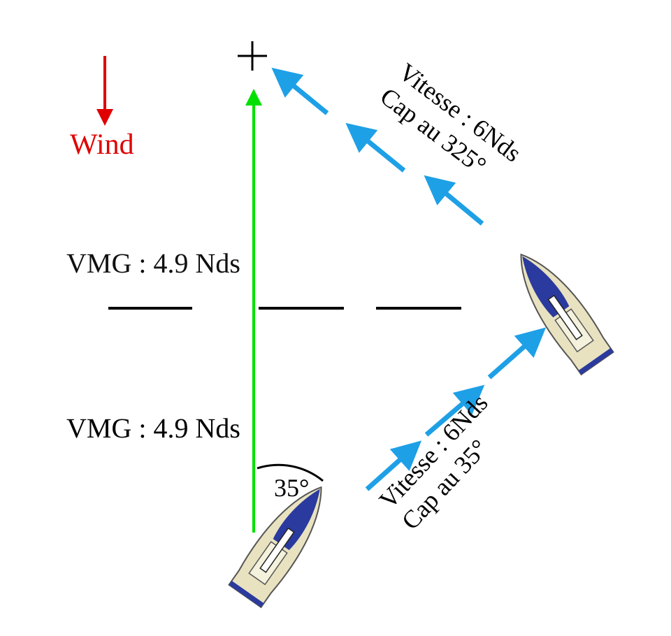
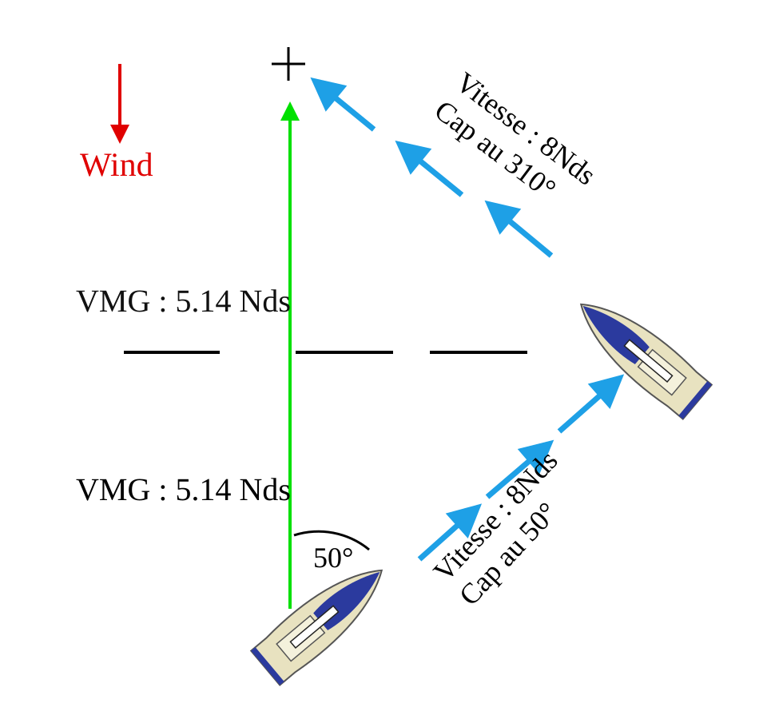
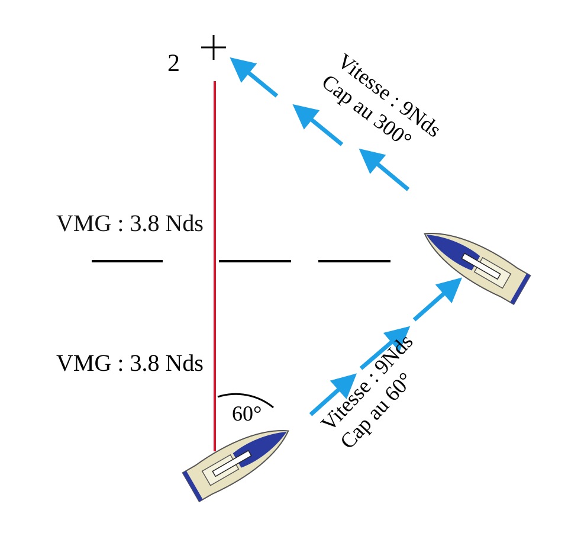

<iframe src="https://yakb.n4n5.dev/animations/?animation=boat_wind" height="50vh" width="100%" style="height: 50vh !important"></iframe>

## VMG (Velocity Make Good)

It’s not how fast your boat is moving through the water – it’s how fast you’re moving towards where you actually want to go.

| VMG at 35deg                      | VMG at 50deg                       | VMG at 60deg                       |
|:---------------------------------:|:----------------------------------:|:----------------------------------:|
| |  |  |
| 6 * cos(35) = 4.9                 | 8 * cos(50) = 5.14    (best)       | 9 * cos(60) = 3.8                  |

## Beaufort Scale (Wind)

| Beaufort | Wind (km/h) | Wind (knots) | Description     | French description |
| -------- | ----------- | ------------ | --------------- | ------------------ |
| 0        | 0-1         | 0-1          | Calm            | Calme              |
| 1        | 1-5         | 1-3          | Light air       | Très légère brise  |
| 2        | 6-11        | 4-6          | Light breeze    | Légère brise       |
| 3        | 12-19       | 7-10         | Gentle breeze   | Petite brise       |
| 4        | 20-28       | 11-16        | Moderate breeze | Jolie brise        |
| 5        | 29-38       | 17-21        | Fresh breeze    | Bonne brise        |
| 6        | 39-49       | 22-27        | Strong breeze   | Vent frais         |
| 7        | 50-61       | 28-33        | Near gale       | Grand frais        |
| 8        | 62-74       | 34-40        | Gale            | Coup de vent       |
| 9        | 75-88       | 41-47        | Strong gale     | Fort coup de vent  |
| 10       | 89-102      | 48-55        | Storm           | Tempête            |
| 11       | 103-117     | 56-63        | Violent storm   | Violente tempête   |
| 12       | > 117       | > 63         | Hurricane       | Ouragan            |
